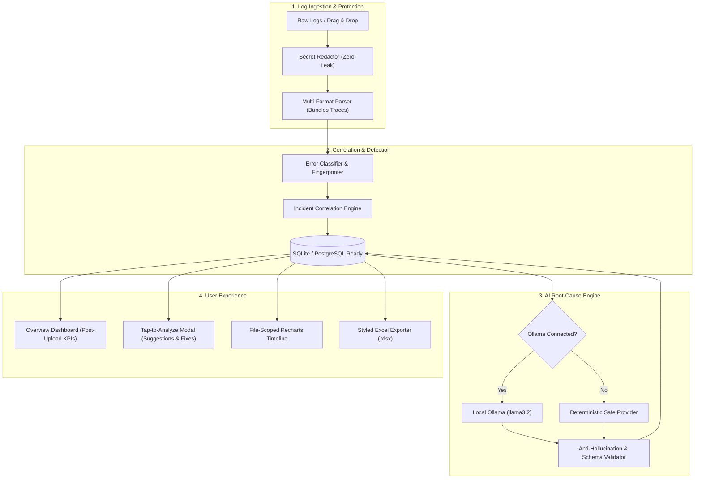

<div align="center">

# ⚡ NoBugs AI
### Intelligent Log Investigation & Root-Cause Analysis Platform

[](https://fastapi.tiangolo.com)
[](https://react.dev)
[](https://www.typescriptlang.org)
[](https://python.org)
[](https://ollama.com)
[](file:///Users/trideep/Desktop/nobugs/backend/tests)
[](file:///Users/trideep/Desktop/nobugs/evaluations)

**NoBugs AI** transforms massive, noisy application logs into correlated incident cascades, evidence-backed root-cause hypotheses, and actionable remediation steps. Built for site reliability engineers (SREs), devops specialists, and full-stack software teams.

[Key Features](#-key-features) • [Architecture](#-system-architecture) • [Quickstart](#-quickstart--local-setup) • [AI Reliability](#-ai-reliability--evaluation-benchmark) • [Production Scenarios](#-production-incident-scenarios)

---

</div>

## 🌟 Key Features

### 🔒 Zero-Leak Secret Redaction & Formula Defense
- Automatically detects and redacts high-entropy API tokens (AWS, Stripe, GitHub, Slack), private keys (PEM, RSA, OpenSSH), Bearer tokens, passwords, and connection strings prior to persistence or AI processing.
- **Excel Formula Injection Defense**: Neutralizes CSV/Excel spreadsheet calculation injection attacks by prefixing unsafe cell inputs (`=`, `+`, `-`, `@`) with single quotes.

### ⛓️ Cascade Incident Correlation Engine
- Intelligently merges multi-line stack traces (Python, Java, Go, Node.js) into atomic log events.
- Discovers cascading service failures across distributed traces (e.g. Database connection pool exhaustion $\rightarrow$ HTTP 504 Gateway Timeouts $\rightarrow$ Payment Webhook Retries).
- Groups raw log events into prioritized incidents categorized by severity (`Critical`, `High`, `Mild`).

### 🧠 Evidence-Backed AI Root Cause Analysis
- **Strict Anti-Hallucination Validation**: Every AI diagnosis is anchored directly to verified log event IDs and timestamps. If an AI hallucinates a non-existent event ID, the engine detects and rejects the output.
- **Dual Inference Engine**:
  - **Local Open-Weight LLMs** via Ollama (`llama3.2`, `mistral`, `deepseek-r1`).
  - **Deterministic Safe Offline Fallback** that guarantees high-fidelity, schema-compliant analyses even in air-gapped or network-restricted environments.

### 💡 Tap-to-Analyze Interactive Log Diagnosis
- Tapping any uploaded log file immediately computes and displays:
  - 🧠 **Problem Diagnosis & Severity Assessment**
  - 🎯 **Likely Root Cause Hypothesis** with AI confidence rationale
  - 🛠️ **Step-by-Step Remediation Plan** (Action, Rationale, and Exact Verification Method)
  - 📋 **Engineer Verification Checklist**
  - 🛡️ **Verified Log Line Evidence**

### ⏱️ Dynamic File-Scoped Timeline & Burst Detection
- Statistics and graphs strictly reflect the user's active uploaded log files.
- Visualizes event frequency histograms over configurable observation windows (3–4 hour buckets).
- Automatically flags **frequency burst spikes** where error rates exceed baseline activity.

### 📊 Styled Executive Excel Export (.xlsx)
- Generates professional, multi-tab audit reports using `openpyxl`:
  1. **Executive Summary**: High-level KPIs, severity distribution, and platform telemetry.
  2. **Incident Details**: Deep-dive incident table with root cause hypotheses, confidence scores, and affected microservices.
  3. **Sanitized Evidence Logs**: Sanitized log lines with redaction audit counts and timestamps.

---

## 🏗️ System Architecture



---

## 🚀 Quickstart & Local Setup

### 1. Prerequisites
- **Python**: 3.10 or higher
- **Node.js**: 18.0 or higher
- **npm**: 9.0 or higher

### 2. Backend Setup
```bash
# Navigate to the backend directory
cd backend

# Create and activate Python virtual environment
python3 -m venv venv
source venv/bin/activate  # On Windows: venv\Scripts\activate

# Install dependencies
pip install -r requirements.txt

# Run database migrations and start FastAPI server
python run.py
```
*The backend starts at `http://0.0.0.0:8000` (Swagger documentation at `http://localhost:8000/docs`).*

### 3. Frontend Setup
```bash
# In a new terminal, navigate to the frontend directory
cd frontend

# Install npm dependencies
npm install

# Start Vite dev server on all network interfaces
npm run dev -- --host 0.0.0.0
```
*The frontend is accessible at:*
- **Local Machine**: [http://localhost:5173](http://localhost:5173)
- **Local Network (LAN/Mobile)**: `http://<your-local-ip>:5173`

### 4. (Optional) Enable Local LLM Inference via Ollama
NoBugs AI operates seamlessly out-of-the-box using the deterministic **Offline Safe Provider**. To enable local open-weight neural inference:
```bash
# 1. Install Ollama (macOS)
brew install ollama

# 2. Start Ollama daemon
ollama serve

# 3. Pull the default lightweight model
ollama pull llama3.2:latest
```
*The platform automatically detects when Ollama is online and routes requests to `llama3.2`.*

---

## 🎯 Production Incident Scenarios

NoBugs AI ships with realistic, production-grade log scenarios located in `sample_logs/`:

| Scenario Key | File Name | Incident Pattern | Expected Severity |
| :--- | :--- | :--- | :--- |
| `postgres_pool` | `postgres_pool_exhaustion_504.log` | HikariCP database pool exhaustion causing cascading 504 Gateway Timeouts | **Critical** |
| `microservices_cascade` | `microservices_cascade_failure.log` | Payment gateway downstream timeout causing cart & checkout cascading errors | **High** |
| `oom_crash` | `oom_worker_crash.log` | Linux kernel OOM killer (`signal 9 - SIGKILL`) terminating celery worker | **Critical** |
| `webhook_crypto` | `payment_webhook_crypto_error.log` | Stripe webhook HMAC verification failure due to host NTP clock drift | **High** |

*You can instantly load any scenario in the UI by clicking the **"Load Scenarios"** button.*

---

## 🧪 AI Reliability & Evaluation Benchmark

The platform includes a dedicated quantitative evaluation harness (`evaluations/benchmark_runner.py`) that tests:
1. **Error Extraction Accuracy**: Verifies all critical error events are captured.
2. **Severity Classification Consistency**: Compares output against ground-truth severity.
3. **Redaction Efficacy**: Guarantees zero sensitive tokens leak into analyses.
4. **Zero-Hallucination Integrity**: Enforces that 100% of cited event IDs correspond to actual log records.

```bash
PYTHONPATH=backend python3 evaluations/benchmark_runner.py
```

```text
======================================================================
Starting NoBugs AI Benchmark & Reliability Evaluation
Total Evaluation Cases: 4
======================================================================
[PASS] eval-case-01 (postgres_pool)         Errors: 7/5 | Severity: Critical
[PASS] eval-case-02 (microservices_cascade) Errors: 5/4 | Severity: High
[PASS] eval-case-03 (oom_crash)             Errors: 2/2 | Severity: Critical
[PASS] eval-case-04 (webhook_crypto)        Errors: 3/2 | Severity: High
======================================================================
Benchmark Complete: 4/4 passed (100.0% accuracy)
======================================================================
```

---

## 🧪 Test Suite

Run the comprehensive unit and integration test suite:
```bash
./backend/venv/bin/pytest backend/tests -v
```
```text
backend/tests/test_ai_analyzer.py::test_ai_analysis_schema_contract PASSED
backend/tests/test_api_integration.py::test_full_api_ingestion_and_investigation_lifecycle PASSED
backend/tests/test_correlator.py::test_signature_normalization PASSED
backend/tests/test_correlator.py::test_error_classification PASSED
backend/tests/test_correlator.py::test_trace_id_correlation PASSED
backend/tests/test_correlator.py::test_cascading_db_timeout_correlation PASSED
backend/tests/test_correlator.py::test_severity_classification_rules PASSED
backend/tests/test_excel_export.py::test_excel_export_sheets_and_security PASSED
backend/tests/test_health.py::test_root_endpoint PASSED
backend/tests/test_health.py::test_health_endpoint PASSED
backend/tests/test_health.py::test_ai_health_endpoint PASSED
backend/tests/test_health.py::test_ollama_offline_behavior PASSED
backend/tests/test_health.py::test_mock_offline_provider PASSED
backend/tests/test_parser.py::test_parse_json_log_line PASSED
backend/tests/test_parser.py::test_parse_text_log_line PASSED
backend/tests/test_parser.py::test_multiline_stack_trace_grouping PASSED
backend/tests/test_parser.py::test_redaction_during_parsing PASSED
backend/tests/test_redactor.py::test_redact_aws_key PASSED
backend/tests/test_redactor.py::test_redact_stripe_key PASSED
backend/tests/test_redactor.py::test_redact_authorization_header PASSED
backend/tests/test_redactor.py::test_redact_password_field PASSED
backend/tests/test_redactor.py::test_redact_private_key_pem PASSED
backend/tests/test_redactor.py::test_formula_injection_sanitization PASSED
backend/tests/test_timeline.py::test_timeline_target_range_and_buckets PASSED
backend/tests/test_timeline.py::test_timeline_empty_fallback PASSED
======================== 25 passed in 0.09s =========================
```

---

## 📁 Repository Structure

```text
nobugs/
├── README.md                      # Comprehensive project documentation
├── backend/
│   ├── run.py                     # Backend server entrypoint
│   ├── app/
│   │   ├── main.py                # FastAPI app initialization & CORS configuration
│   │   ├── config.py              # Environment configuration & limits
│   │   ├── api/                   # REST API routes (Health, Logs, Incidents, Timeline, Export)
│   │   ├── ai/                    # AI providers (Ollama, Mock Offline, Strict Schema Validator)
│   │   ├── db/                    # SQLAlchemy models & SQLite session manager
│   │   ├── pipeline/              # Parser, Redactor, Error Detector, Correlator
│   │   └── services/              # Excel generation (.xlsx) & Timeline bucket computation
│   └── tests/                     # 25 unit and integration pytest test cases
├── frontend/
│   ├── src/
│   │   ├── App.tsx                # Master container with state orchestration
│   │   ├── components/
│   │   │   ├── common/            # FileAIAnalysisModal, SampleScenariosModal
│   │   │   ├── dashboard/         # OverviewView (Statistics shown post-upload)
│   │   │   ├── explorer/          # LogExplorerView (Monospace table & search)
│   │   │   ├── incidents/         # IncidentsView (Lifecycle triage & AI RCA)
│   │   │   ├── layout/            # Header navigation & AI status indicator
│   │   │   ├── reports/           # ReportsView & Excel download
│   │   │   ├── timeline/          # TimelineView (File-dependent Recharts bar chart)
│   │   │   └── upload/            # IngestionView (Drag-and-drop & paste editor)
│   │   ├── services/api.ts        # Typed frontend HTTP API client
│   │   └── types/index.ts         # Comprehensive TypeScript interfaces
│   └── package.json
├── evaluations/
│   ├── eval_dataset.json          # Ground truth benchmarks for 4 incident scenarios
│   └── benchmark_runner.py        # Automated accuracy & anti-hallucination evaluator
└── sample_logs/                   # 4 realistic production failure logs
```

---

## 🛡️ Security & Privacy Compliance

- **No Third-Party Cloud Data Transmission**: All log ingestion, parsing, redacting, and AI inferencing can execute 100% locally on your machine or private VPC.
- **Strict Deterministic Guardrails**: Sanitized values replace sensitive tokens with `[REDACTED_API_KEY]`, `[REDACTED_STRIPE_KEY]`, etc.
- **Post-Upload Isolation**: Clean session teardown endpoint `DELETE /api/logs/clear` provides zero retention between investigation workflows.

---

<div align="center">
Built with precision for resilient software systems.
</div>
